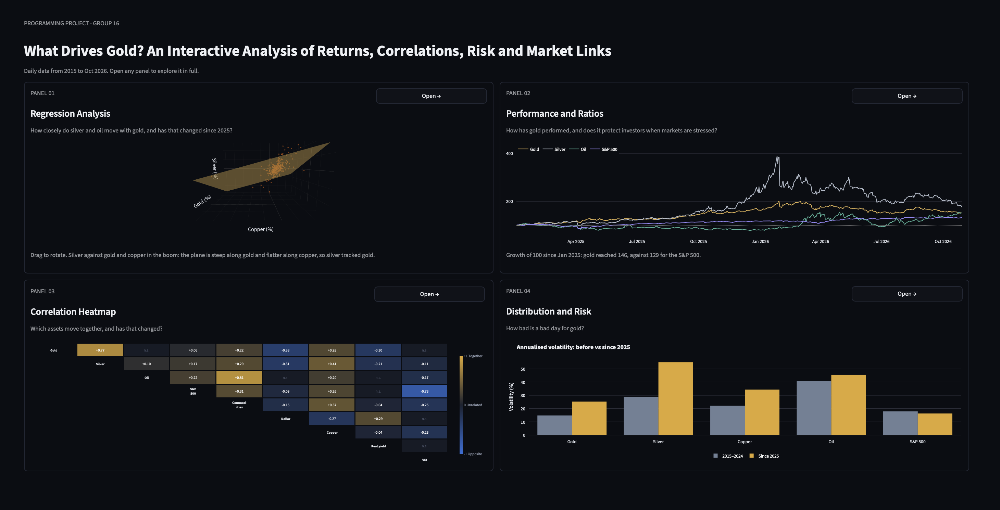
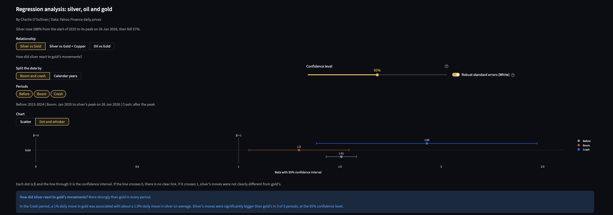
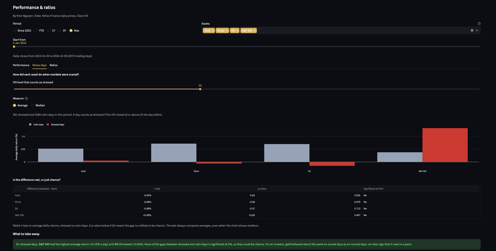
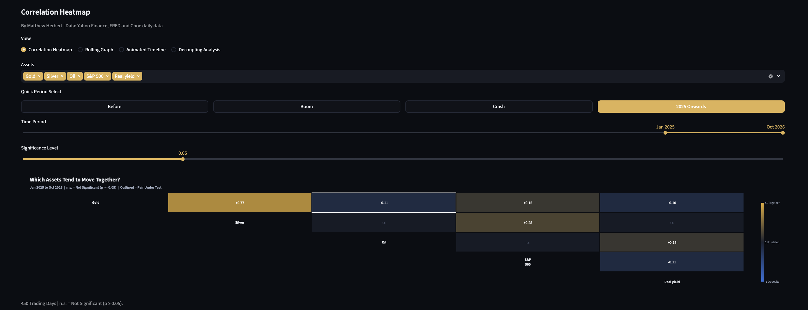
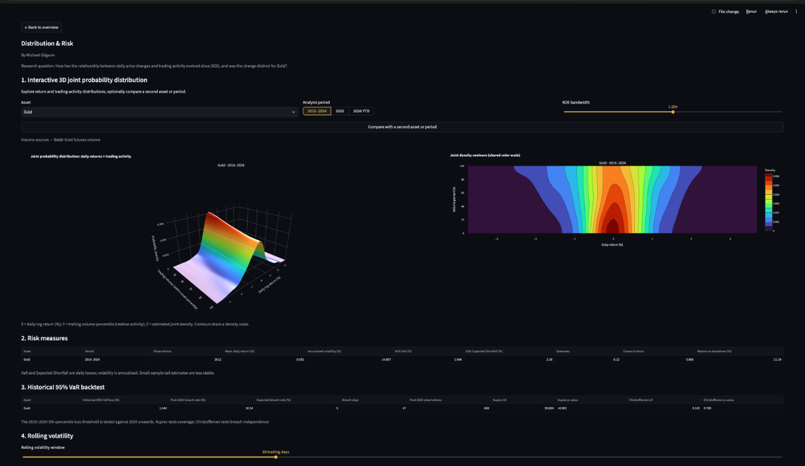

# What Drives Gold? An Interactive Analysis of Returns, Correlations, Risk and Market Links

**Main question:** What drives the price of gold, and has its behaviour changed since 2025?

This interactive dashboard looks at gold alongside silver, oil, the S&P 500 and several economic factors (the US dollar, copper, a broad commodity index, the 10-year real yield and the VIX), using daily data from 2 January 2015 to 30 October 2026. Each of the four panels answers one part of the main question, and each compares the years before 2025 with the period since.

## What we found
In this data, gold moved most closely with silver and against the US dollar and real yields, and since 2025 its behaviour clearly changed:
- **The textbook drivers weakened.** Gold's negative link with real yields almost disappeared after 2025 (r = −0.36 before, −0.10 since; Panel 3), so higher real yields no longer held gold back during the boom.
- **Gold became a higher-return, higher-risk asset.** Since 2025 it returned 23.2% a year with 25.1% volatility, against 10.6% and 16.8% over the full period, and it is now in its deepest fall since 2015 (−26.7% from its January 2026 peak; Panel 2).
- **It did not act as a reliable safe haven.** Gold's returns on high-fear days were not significantly different from normal days (Panel 2), and in the 2026 crash it moved *with* the S&P 500 (r = 0.36) rather than against it (Panel 3).
- **Silver amplified gold throughout.** Silver moved more than one-for-one with gold in every period (β 1.51 before 2025, 1.93 in the crash) and tracked gold far more than copper, so it behaved as a precious metal rather than an industrial one (Panel 1).
- **Gold's bad days got worse.** Its average loss on the worst 5% of days rose from 2.18% before 2025 to 3.91% since, and a 95% risk limit based on 2015–2024 data was broken on 10.2% of days instead of the expected 5% (Panel 4).

These are links in past data, not proof of what causes gold's moves. Each panel's section below explains how its result was calculated and its limitations.

## Quick start

You need Python 3.12 or newer (check with `python3 --version`). Tested with Python 3.14.7 on macOS.

**1. Download the code.** Clone the repository and move into the project folder.
```bash
git clone https://github.com/kiennguyen1508/Programming-Project-Group-16.git
cd Programming-Project-Group-16
```

**2. Set up a virtual environment.** This keeps the project's packages separate from anything else installed on your computer.
```bash
python3 -m venv .venv
source .venv/bin/activate
```

On Windows, use `python -m venv .venv` and then `.venv\Scripts\activate`.
If activation worked, your terminal prompt should start with `(.venv)`.

**3. Install the packages.** This installs everything listed in `requirements.txt`.
```bash
pip install -r requirements.txt
```

**4. Run the dashboard.**
```bash
python -m streamlit run app.py
```
**Run every command from inside the project folder** (the one containing `app.py`). Starting the app from a different folder stops it from finding the data files.

Using `python -m` runs the Streamlit installation in the active virtual environment. The dashboard opens at [http://localhost:8501](http://localhost:8501). If that port is busy, Streamlit selects another port and prints its address in the terminal.

All the data the dashboard needs is already saved in `data/`, including the trading-volume history used by the Distribution & Risk panel, so the dashboard runs without an internet connection.

## Using the dashboard

The dashboard opens on an overview page with a preview of all four panels. Select **Open →** to view a panel and its controls, then **← Back to overview** to return. Each panel ends with a section explaining its method and limitations.



## Data

All data is daily, from 2 January 2015 to 30 October 2026. It comes from Yahoo Finance, FRED (Federal Reserve Bank of St. Louis) and Cboe.

| File | What it contains | Source |
|---|---|---|
| `data/prices.csv` | Closing prices of gold futures (`GC=F`), silver futures (`SI=F`), Brent crude futures (`BZ=F`) and the S&P 500 (`^GSPC`). Only days when all four traded are kept. | Yahoo Finance |
| `data/macro.csv` | US dollar index (`DX-Y.NYB`), copper futures (`HG=F`), a broad commodity ETF (`DBC`), the 10-year real yield (`DFII10`) and the VIX. Kept separate from the prices so that adding it did not change any panel's existing results. | Yahoo Finance, FRED, Cboe |
| `data/VIX_History.csv` | Daily VIX history, used to build the VIX column in `macro.csv`. | Cboe |
| `data/volume_history.csv` | Daily raw trading volumes for each asset, used by the Distribution & Risk panel to calculate trailing volume percentiles. Included in the repository; the panel only downloads new volume data if this file does not cover the dates it needs. | Yahoo Finance |
| `data/volume_history_sources.json` | Labels identifying the futures volume series or ETF proxy used for each asset. | Yahoo Finance |
| `data/DFII10.csv` | A saved copy of the 10-year real yield. Not read by any code: `data_loader.py` downloads the real yield directly from FRED. Kept for reference. | FRED |
| `data/GVZCLS.csv`, `data/SKEW.csv` | Gold volatility index and Cboe SKEW index, downloaded while exploring extra drivers. Not used by any panel. | FRED, Cboe |
| `data/volume_percentiles.csv`, `data/volume_percentiles_sources.json` | An older version of Panel 4's volume data that ranked volume against the full sample (which would use future information). Replaced by `volume_history.csv` and no longer used. | Yahoo Finance |

### Refreshing the data

This is optional, needs an internet connection, and is **not needed to run the dashboard**. It overwrites the saved CSV files.

```bash
python data_loader.py           # re-downloads prices.csv
python data_loader.py macro     # re-downloads macro.csv
```

Before refreshing, note three things:
- **The end date is fixed.** `END = "2026-11-01"` in `data_loader.py` stops every download at 31 October 2026. To get newer data, change that date first.
- **The VIX is not downloaded automatically.** `macro.csv` takes the VIX from the saved `data/VIX_History.csv`. To update it, download the latest VIX history CSV from Cboe's website and save it over that file before running `python data_loader.py macro`.
- **The results will change.** Every number in the Key findings sections comes from the saved data up to 30 October 2026, so refreshed data will give different figures.

The Distribution & Risk panel downloads new volume data by itself only if `data/volume_history.csv` does not cover the dates it needs. To force a fresh download, delete `data/volume_history.csv` and `data/volume_history_sources.json`, then restart the app while online.

### Running the regression notebook (optional)

`charlie_regression.ipynb` checks Panel 1's hand-calculated regressions against `statsmodels`. It is not needed for the dashboard and needs two extra packages:
```bash
pip install statsmodels jupyter
jupyter notebook charlie_regression.ipynb
```

### Using the data in a panel
`data_loader.py` provides shared price, return and macro-data functions. Panels may apply different return definitions or additional date and missing-data filters to suit their analyses.

| Function | What it returns |
|---|---|
| `get_prices()` | Daily closing prices, one column per asset |
| `get_returns()` | Daily log returns of the four assets |
| `get_macro()` | Levels of the macro series |
| `get_macro_changes()` | Daily changes of the macro series: log returns for prices, basis points for the real yield, points for the VIX |
| `SPLIT` | The date used to split "before" and "since 2025" (`2025-01-01`) |

## Project structure

```
Programming-Project-Group-16/
├── app.py                    # puts the four panels on one page
├── data_loader.py            # downloads, saves and loads the shared data
├── requirements.txt          # packages to install
├── .streamlit/config.toml    # dashboard theme
├── data/                     # saved CSV files
├── panels/
│   ├── __init__.py           # lets app.py import the panels
│   ├── Charlie.py            # regression
│   ├── Kien.py               # performance and ratios
│   ├── Matthew.py            # correlation heatmap
│   └── Michael.py            # distribution and risk
├── charlie_regression.ipynb  # notebook used while building the regression panel
└── assets/                   # screenshots used in this README
```

## The panels
Each panel also explains its method and limitations in the app.

### Panel 1: Regression analysis of silver, oil and gold (Charlie O'Sullivan)
**Question:** How did silver respond to gold during the 2025 boom and 2026 crash? Did silver behave more like a precious or industrial metal, and did the oil-gold relationship change in 2026 amid tensions involving Iran?

**Link to the main question:** Gold is the explanatory variable in every regression, so each β shows how silver or oil moved with gold, and whether that changed after 2025.

**Data:** Daily log returns for gold, silver and Brent oil from `prices.csv`, and copper from `macro.csv`, loaded through `data_loader.py`. Silver rose 288% from the start of 2025 to its peak on 26 January 2026, then fell 57%. The panel splits the data at that peak (Before: 2015-2024; Boom: January 2025 to the peak; Crash: after the peak) or by calendar year (2015-2024, 2025 and 2026 YTD).

**Data preprocessing:** How the raw prices are turned into the data the regressions use.
1. **Raw data.** Daily closing prices for gold (`GC=F`), silver (`SI=F`), Brent crude (`BZ=F`) and the S&P 500 are downloaded from Yahoo Finance by `data_loader.py` and saved in `data/prices.csv`. Only dates when all four assets traded are retained. Copper futures (`HG=F`) come from `data/macro.csv`.
2. **Prices to returns.** `data_loader.py` converts prices to daily log returns, ln(price today) − ln(price yesterday). The panel loads gold, silver and oil returns with `get_returns()`, and copper returns with `get_macro_changes()`. Regressing trending price levels can produce spurious relationships; returns reduce this problem. With returns expressed consistently, β estimates the change in the dependent asset's return associated with a one-unit change in gold's return.
3. **Joining copper.** Copper's daily returns are joined onto the other returns by date. Any day missing a value for the assets in a regression is dropped with `dropna()`, which is why the Silver vs Gold + Copper regressions have a few fewer days (for example 2,508 before 2025, against 2,512 for Silver vs Gold).
4. **Finding silver's peak.** The boom and crash split is calculated from `get_prices()` as silver's highest close since 1 January 2025 (26 January 2026 in the saved data), so it can update when the data is refreshed. The same prices determine the rise and fall shown under the panel title.
5. **Splitting into periods.** pandas date slicing (`.loc[start:end]`) cuts the returns into Before (2015-2024), Boom (Jan 2025 to the peak) and Crash (after the peak), or into calendar years (2015-2024, 2025, 2026 YTD).
6. **Regression inputs.** For each period, returns are passed to `run_ols`, which adds a column of ones for the intercept and estimates the model using a matrix formula. The results (β, standard error, confidence interval, t-statistic, R² and observation count) feed the panel's charts and text.
7. **For the charts.** In the scatter and 3D charts, returns are multiplied by 100 so the axes show daily % moves. This does not change β, because both sides of the regression are scaled the same way.

**What it shows:** Three regressions, each run separately for every chosen period.
- **Silver vs Gold:** silver's average daily move for each 1% daily move in gold (β). β above 1 means silver's moves were bigger than gold's.
- **Silver vs Gold + Copper:** a multiple regression with one β for each metal, holding the other constant, to see whether silver tracked gold (precious) or copper (industrial) more closely.
- **Oil vs Gold:** whether oil and gold moved in the same direction, opposite directions, or had no clear link.

The OLS estimates are calculated by hand with the matrix formula and checked against statsmodels in `charlie_regression.ipynb`. Each relationship has a scatter with fitted lines, a dot and whisker chart of each β with its confidence interval, and, for the copper regression, a rotatable 3D plane. Under the chart, a blue box answers the question in plain words, followed by the full results table (downloadable as a CSV). "What the results mean" explains each β, tests whether β changed significantly between periods (a z-test) and ends with a practical takeaway.



**Controls:** Relationship, period scheme (boom/crash or calendar years), selected periods, chart type, confidence level (90%, 95% or 99%) and a toggle for White robust standard errors.

**Key findings:**
- Silver moved more than one-for-one with gold in every period: β was 1.51 before 2025, 1.30 in the boom and 1.93 in the crash. The rise from boom to crash was significant at the 95% level (z = 2.08) but not at 99%, so silver's daily moves were largest relative to gold's after the peak.
- Holding copper constant, silver tracked gold more closely than copper in every period (β on gold 1.41, 1.15 and 1.60, against 0.26, 0.27 and 0.65 on copper), so it behaved more like a precious metal even during the boom.
- Oil and gold had a small positive link from 2015 to 2024 (β = 0.23), no clear link in 2025, and a negative link in 2026 (β = -0.37, 95% CI -0.72 to -0.03). The change from 2025 to 2026 was significant (z = -2.38), but gold explained only about 3% of oil's daily moves, so the link was weak.
- Robust standard errors matter here: in the crash, silver's standard error on gold is 0.28 with them and 0.09 without, because volatility after the peak was far from constant.

### Panel 2: Performance and ratios (Kien Nguyen)
**Question:** How has gold performed against the other assets, and does it protect investors when markets are stressed?

**How it answers the main question:** If gold is a safe haven, it should hold up on fear days and fall less than other assets in bad periods. This panel tests that directly and compares the period since 2025 with the full 2015-2026 history.

#### Data handling and transformation
**1. Data used.** Gold, silver, Brent oil and the S&P 500 come from `prices.csv` through `get_prices()`: 2,972 trading days from 2 Jan 2015 to 30 Oct 2026, with no missing values. Copper and the VIX come from `macro.csv` through `get_macro()`.

**2. Joining copper without losing price days.** Copper is added with a *left join* on the price dates. An inner join would remove gold, silver and oil dates whenever copper has no price. With a left join, those dates are retained and copper is blank; missing copper observations are excluded only when calculating the Gold/Copper ratio. No missing price is filled in.

**3. Simple returns instead of log returns.** The regression and risk panels use log returns for price assets, while the correlation panel also uses percentage changes for several macro series. This panel uses simple daily returns (`pct_change`) to report investor-facing measures such as growth of 100, total return, Sharpe and Sortino. The difference matters on large moves: on 30 January 2026, silver's simple return was −31.3%, while its log return was −37.6%.

**4. Rebasing to 100.** Gold and silver have very different price scales, so their raw prices cannot share a useful comparison chart. Each price is divided by its first value in the selected period and multiplied by 100, so each line starts at 100 and shows relative growth.

**5. Annualising.** Annualised return = (1 + total return)^(1 / years) − 1; annualised volatility = daily standard deviation × √252. For periods shorter than a year, the panel shows a warning because annualised figures can look extreme.

**6. Avoiding look-ahead bias.** Two tests use only information that would have been available at the time:
- **Stress days** use the VIX close from the *previous* trading day. Same-day VIX would be circular, because the VIX jumps on the same days stocks fall.
- **The reversion test** compares each day's ratio with a *rolling* 5-year average and σ, not the full-sample average, and only starts once 2 years of history exist (from about January 2017). Using the full-sample average would mean judging 2018 with knowledge of 2026.

**7. Two different averages for the ratios.** The ratio chart's bands, z-score and percentile use the full 2015–2026 history, so the reference average stays fixed when a different period is selected. The reversion test uses the rolling average described above, reflecting the information available at each date.

**8. Extreme days retained.** Large moves, including silver's decline on 30 January 2026 and the S&P 500's +9.5% move on 9 April 2025, were checked and retained because they are relevant to the analysis. The Stress days tab offers the median as well as the average so a single extreme day has less influence on the summary.

**9. Sample size after each step.** Full period: 2,971 return days, of which 391 are stressed (VIX ≥ 25 the day before) and 2,580 calm. Since 2025: 458 return days, of which only 34 are stressed and 424 calm. "Since 2025" starts from the first close of 2025 (2 January), so the first return counted is 3 January; Panel 4 calculates returns over the full history before splitting, so it counts 459 days.

**10. Testing whether the stress-day gap is real.** Each asset's stressed-day returns are compared with its calm-day returns using Welch's t-test (`scipy.stats.ttest_ind` with `equal_var=False`). Welch's version is used instead of the standard t-test because returns are much more volatile on stressed days, so the two groups do not have the same variance.

#### What you see
Three tabs, each ending with a green "What to take away" box that states the result and what it means for an investor:
1. **Performance:** a chart (Growth of 100, Drawdown or Replay) and a table of total return, annualised return, volatility, maximum drawdown, Sharpe ratio and Sortino ratio, with the best value in each column highlighted.
2. **Stress days:** each asset's average (or median) daily return on calm days and on stressed days, and a Welch t-test table showing the gap, t-statistic, p-value and whether the gap is significant at 5%.
3. **Ratios:** the gold/silver, gold/oil and gold/copper ratios with their 2015–2026 average and ±1σ/±2σ bands, plus the latest value in the saved data, z-score and percentile. Below this, the reversion test shows how often a ratio moved back towards its average after being more than 2σ away, alongside a base rate (how often it moved that way on any day).

#### How to read it
- **Sharpe and Sortino:** return per unit of risk; higher is better. Sortino only counts days below the risk-free rate as risk.
- **Drawdown:** how far an asset is below its previous peak; closer to 0% is better.
- **Stress days:** if gold protects investors, its stressed-day bar should be at or above its calm-day bar and above the S&P 500's.
- **p-value:** below 0.05 means the gap between stressed and calm days is unlikely to be chance. Above 0.05, the bars may look different but the gap could be noise.
- **Reversion test:** the signal only means something if "Moved back towards mean" is clearly higher than the base rate.



#### Controls
Period (Since 2025, YTD, 1Y, 5Y, Max; default Since 2025), asset picker and a "Start from" slider. Performance tab: chart type (Growth of 100, Drawdown, Replay), log-scale toggle and risk-free rate slider (0–6%, default 4%). Stress days tab: VIX threshold (15–40, default 25) and Average/Median. Ratios tab: ratio picker and look-ahead horizon (1, 3 or 6 months). A CSV download of the prices and a "Method and limitations" section are at the bottom of the panel.

#### Key findings
Saved data to 30 Oct 2026; the settings to reproduce each finding are in brackets.
- **Since 2025, gold earned more but became riskier.** Annualised return 23.2% with 25.1% volatility and a Sharpe ratio of 0.80, the highest of the four assets, against 10.6%, 16.8% and 0.45 over the full period. Silver and oil returned more since 2025 (32.1% and 27.2%) but with far higher volatility (52.8% and 45.1%). *[Performance, Since 2025 vs Max]*
- **Gold is in its deepest fall since 2015.** It peaked at $5,318 on 29 Jan 2026 and closed at $3,899 on 30 Oct 2026, a 26.7% drawdown. That is deeper than any fall from 2015 to 2024 (the worst was about 21%). *[Performance, Max, Drawdown]*
- **Gold did not reliably protect investors on fear days.** On the 391 stressed days, gold averaged +0.01% a day against +0.05% on calm days, while the S&P 500 averaged +0.13% on stressed days. The median tells the same story for gold: +0.03% on stressed days against +0.05% on calm days, below the S&P 500's +0.12%. None of the gaps is statistically significant (Welch t-test: gold p = 0.53, S&P 500 p = 0.41), so gold behaved about the same on fear days as on normal days. *[Stress days, Max, VIX 25]*
- **Since 2025 gold did rise on stressed days, but so did silver and the S&P 500.** On the 34 stressed days, gold averaged +0.18% (+0.09% on calm days), but the S&P 500 averaged +0.28% and silver +0.27%. None of these gaps is significant at 5% (gold p = 0.83). This looks like markets bouncing back after fear spikes, not gold protecting investors, and 34 days is a small sample. *[Stress days, Since 2025, VIX 25]*
- **Only the gold/silver ratio reliably moved back to its average.** After being more than 2σ from its rolling 5-year average, it moved back within 3 months 81% of the time, against a base rate of 43–57%. Gold/oil (53% vs 47%) and gold/copper (54% vs 45%) were barely better than chance. On 30 Oct 2026 the gold/silver ratio was 79.4, right at its average (z = −0.04, 50th percentile), so there was no signal at the end of the data. *[Ratios, 3 months]*

#### Limitations
- The "since 2025" period is under two years and has only 34 stressed days, so those results are less certain than the full-period ones.
- The t-test assumes each day is independent, but stressed days come in runs (volatility clusters), so the p-values are only approximate. Four assets are tested at once, so one "significant" result could appear by chance.
- The reversion test counts overlapping days (259 above +2σ and 105 below −2σ for gold/silver), so the number of independent episodes is much smaller than the day counts suggest.
- Ratios can spike far upwards but cannot fall below zero, so the σ bands are only approximate. The percentile is more reliable.
- The risk-free rate is fixed for the whole period (default 4%), but cash rates were near zero until 2022, so Sharpe and Sortino over Max are only approximate.
- Futures prices jump slightly when contracts roll over, and the S&P 500 is a price index without dividends, which understates its return.
- The panel describes the past and is not a forecast.

### Panel 3: Correlation Heatmap (Matthew Herbert)
**Question:** Which assets move together with gold, and did those links change in relation to various economic events?

**Data:** The panel draws on files in the `data/` folder:
- `data/prices.csv`: Daily closing prices for Gold, Silver, Oil and the S&P 500 from Yahoo Finance, loaded through `get_returns()` in `data_loader.py`.
- `data/macro.csv`: Daily levels for commodities, the US dollar and Copper, plus the 10-year real yield and VIX. The panel loads this file with its `load_macro()` function.
- `data/VIX_History.csv`: Supplies the VIX values used in `macro.csv`.

Gold, Silver, Oil and the S&P 500 use daily log returns. Commodity, dollar, copper and VIX series use daily percentage changes; the real yield uses the daily change in percentage points. Dates with incomplete data are excluded from the panel's complete-case analysis.

**1. Loading the data.** The panel uses two saved files, so it runs without internet:
- `data/prices.csv` (2,972 trading days, 2 Jan 2015 to 30 Oct 2026): Gold, Silver, Brent Oil and the S&P 500. It is read through the shared `get_returns()` function in `data_loader.py`.
- `data/macro.csv` (2,980 days over the same dates): Commodities (DBC), the Dollar index, Copper, the 10-year real yield and the VIX. It is read directly by the panel's own `load_macro()` function, with the Date column parsed as the index.

**2. Turning prices into returns.** Correlating price levels can show misleading links between assets that both trend over time, so each series is converted to a daily change:
- Gold, Silver, Oil and the S&P 500 use daily log returns, ln(Pₜ / Pₜ₋₁). Other panels may use different return definitions for their analyses.
- Commodities, the Dollar, Copper and the VIX use the daily % change (`pct_change()`).
- The real yield is already a rate, so a % change of a yield near zero would give huge, meaningless numbers. It uses the daily change in percentage points instead (`diff()`).

The first day of each series is omitted because calculating a change requires a previous observation.

**3. Matching the dates.** The two tables are combined with an inner join, keeping only dates present in both files (2,971 days). The markets use different calendars, and `macro.csv` has gaps: 25 missing real-yield values, 5 for Copper and Commodities, 4 for the Dollar and 1 for the VIX. A missing value can also leave the following daily change blank.

**4. Removing incomplete days.** `dropna()` removes any date with a blank in any column, leaving **2,925 complete trading days** (46 removed, about 1.5%) in the saved dataset. Every correlation therefore uses the same dates, making pairs easier to compare. No values are filled in or estimated.

**5. Splitting by period.** The shared `SPLIT` date (1 Jan 2025) and the silver peak (26 Jan 2026) divide the data for the quick period buttons:
- Before: 2,475 days (Jan 2015 to Dec 2024)
- Boom: 259 days (1 Jan 2025 to 26 Jan 2026)
- Crash: 191 days (27 Jan 2026 to Oct 2026)

The Animated Timeline groups the data by calendar year, with about 245 to 249 days per year, except 2025 (243) and 2026 (207, January to October only).

**6. Preparing for the statistics.** Correlations are clipped to between -0.999 and +0.999 before the Fisher z-transform (arctanh), since a correlation of exactly ±1 would give an infinite value. The rolling correlation needs a full window before it starts, so the first 29 to 249 days (depending on the window chosen) have no value and are dropped from the graph.

**What Panel 3 shows:**
- **Correlation heatmap:** A staircase heatmap of Pearson correlations (r) for each selected asset pair. Gold indicates positive correlation and blue indicates negative correlation. Pairs that are not statistically significant at the selected threshold are greyed out and marked “n.s.”
- ***Rolling Graph:*** How the correlation between two assets changes over time, with a shaded 95% confidence band. Shaded boxes mark the COVID crash, the Ukraine war and rate hikes, and the selected period. A dotted line marks the silver peak (26 Jan 2026). Dotted average lines compare before and during the selected period, and a row of cards shows the latest, average, lowest and highest r. A second pair can be added for comparison.
- ***Animated Timeline:*** One heatmap per year from 2015 to 2026, played with a Play button or a year slider, to show how the links shift year by year. 2026 covers January to October only.
- ***Decoupling Analysis:*** Compares the selected period with all the days before it. A table ranks every pair by how much its correlation changed, with a Fisher z-test p-value for each change, and can be downloaded as a CSV. It can also be shown as a heatmap of the changes. The "Pair in Focus" section then tests one chosen pair and says in plain words whether the change is real or just random noise.



**Controls:** An assets picker; Quick Period Select buttons (Before, Boom, Crash, 2025 Onwards); a time period slider; and a significance level slider (0.01 to 0.20, default 0.05). The Rolling Graph has its own "Comparing" and "Against" dropdowns and a smoothing window slider (30 to 250 days, default 90). Controls that do nothing on a view are hidden on that view.

**Key findings and interpretations:**
- Over the whole period, gold's strongest link is with silver (r = 0.77). Gold moves against the dollar (r = -0.38) and against real yields (r = -0.30), and has almost no link with the S&P 500, oil or the VIX.
- Gold's link with real yields mostly faded after 2025. It went from -0.36 before 2025 to -0.10 since, which is a significant change (Fisher z-test, p < 0.001). The textbook "higher real yields hurt gold" link broke down during the boom.
- 25 of the 36 pairs changed significantly after 2025. The biggest changes are in oil, which almost stopped moving with the S&P 500 (0.28 to -0.09) and copper (0.28 to -0.06).
- Gold and silver stayed tightly linked throughout. Their 90-day rolling correlation never fell below 0.50, and over the crash as a whole their correlation was 0.84, higher than in the boom (0.64).
- In the crash, gold started moving with the S&P 500 (r = 0.36, against roughly zero before) and against the VIX (r = -0.30). This suggests gold was sold off alongside stocks rather than acting as a safe haven.

**Limitations:** Correlation only measures straight-line links and says nothing about cause. Daily closing times differ across markets, which can weaken some links. Rolling correlations depend on the window chosen, and the boom and crash periods are short, so their estimates are less certain.


### Panel 4: Distribution & Risk (Michael Gilgunn)

**Question:** How bad is a bad day for gold, and how has its daily risk changed since 2025?

**Link to the main question:** While the other panels examine gold's performance and relationships with other markets, this panel focuses on the distribution and risk of its daily returns. It investigates how frequently large movements occur, whether downside risk has changed since 2025, and whether unusually high trading activity is associated with larger price movements. It complements the S&P 500 and real-yield findings elsewhere in the dashboard, but it does not currently calculate joint gold–S&P tail dependence or test real yields directly.

**Data:** The panel combines daily returns, price information and trading-volume data from the project's shared datasets and Yahoo Finance.

- `data/prices.csv`: Daily closing prices for Gold, Silver, Oil and the S&P 500.
- `data/macro.csv`: Copper price data, accessed through the shared data-loading functions.
- `data/volume_history.csv`: Cached daily trading-volume observations.
- `data/volume_history_sources.json`: Identifies the volume source used for each asset.

Volume data is cached locally in `data/volume_history.csv`, so it does not need to be downloaded again on every run. Raw trading volume is converted into a trailing 252-observation percentile for each instrument. Each percentile uses only observations available up to that date, avoiding look-ahead bias. A percentile of 90 means trading activity was higher than approximately 90% of the instrument's previous observations. This allows activity to be compared across markets with very different trading volumes.

Futures volume is used for Gold (GC=F), Silver (SI=F), Oil (BZ=F) and Copper (HG=F), while SPY is used as an ETF proxy for the S&P 500. Volume is converted into a trailing 252-observation percentile for each instrument. This measures current activity relative to its own recent history, rather than comparing raw volumes across markets with very different trading levels. Only information available up to each observation is used, avoiding look-ahead bias.

**Data handling and transformation:**

1. **Loading returns:** Daily log returns are obtained through `get_returns()` in `data_loader.py`. Copper returns are retrieved through `get_macro()` and `get_macro_changes()`.
2. **Volume preparation:** Raw trading volume is converted into a trailing 252-observation percentile separately for each instrument. This standardises activity on a scale from 0 to 100.
3. **Combining the datasets:** Returns and volume percentiles are matched by date so that each observation represents the same trading day.
4. **Cleaning:** Incomplete observations are removed using `.dropna()` separately for each asset. Missing volume values are not estimated, so aligned sample sizes differ between assets.
5. **Period selection:** The shared split date (`2025-01-01`) separates 2015–2024 from the period since 2025. Individual calendar years can also be selected, including 2026 YTD.
6. **Sample sizes:** The number of observations remaining after cleaning is retained for the statistical comparisons, as different assets and periods do not necessarily have identical sample sizes.

**What you see:**

The panel is organised around several complementary views of market risk:

- **Joint Probability Distribution:** An interactive 3D surface uses Gaussian Kernel Density Estimation (KDE) to estimate the joint distribution of daily log returns and trading-volume percentiles. Returns are displayed on the X-axis, volume percentile on the Y-axis and estimated probability density on the Z-axis. This makes it possible to examine which combinations of returns and trading activity occur most frequently.

- **Distribution Comparison:** Users can compare two assets or periods through side-by-side 3D density surfaces and 2D contour plots. Shared density and colour scales make differences in the distributions easier to identify. Reflected observations—copies mirrored at the 0 and 100 percentile boundaries—reduce the artificial loss of density near those boundaries.

- **Risk Measures:** A summary table reports observation count, mean daily return, annualised volatility, 95% Value at Risk (VaR), 95% Expected Shortfall (ES), skewness, excess kurtosis and maximum drawdown. This provides a broader assessment of risk than volatility alone. Annualised volatility is calculated using daily standard deviation multiplied by √252. VaR measures the fifth-percentile daily loss, while ES measures the average loss among observations at or below that threshold. Any row labelled 2026 YTD is a partial-year result, not a full-year estimate.

- **Historical VaR Backtest:** A historical 95% VaR threshold estimated from 2015–2024 is held fixed and tested against returns since 2025. The results show the number and percentage of losses that exceed the threshold. Kupiec's test assesses whether the breach rate is consistent with the expected 5%, while Christoffersen's test examines whether breaches occur independently over time.

- **Rolling Volatility:** A time-series chart tracks annualised volatility using selectable 21, 30, 60 or 90 trading-day windows. A marker at the beginning of 2025 makes it easier to identify changes in volatility between the two periods.

- **Trading Activity and Return Magnitude:** Observations are separated into low- and high-volume terciles within each period. The panel compares mean absolute daily log returns between these groups and calculates the high-minus-low difference. This helps establish whether larger market movements tend to coincide with unusually high trading activity, and whether that relationship has changed since 2025.

- **Distribution and Variance Tests:** Kolmogorov–Smirnov tests compare the shape of the return distributions before and since 2025, while Levene tests examine differences in variance. The results also report the post/pre volatility ratio, sample sizes and Holm-adjusted p-values to account for multiple comparisons.

**Controls:** Users can select an asset and period, or introduce a second asset or period for direct distribution comparisons. The KDE bandwidth can be adjusted from 0.65× to 1.4×, allowing the user to control the smoothness of the estimated density surface. Other controls allow different rolling-volatility windows to be examined. The panel also identifies the volume source used and provides a CSV download of the selected daily returns and corresponding volume percentiles.



**How to interpret the results:**

- A wider distribution along the return axis indicates greater variation in daily price movements.
- A distribution with a longer negative tail indicates more extreme downside observations.
- A higher Expected Shortfall indicates more severe average losses in the worst 5% of observations.
- A positive high-minus-low difference means absolute daily returns were larger during high-volume observations.
- A higher post/pre volatility ratio indicates that daily volatility increased since 2025.
- A VaR breach occurs when a daily loss exceeds the historical threshold. A breach rate above 5% suggests the earlier threshold may be understating subsequent losses.

These results describe historical relationships and do not establish that trading activity causes larger price movements.

**What to take away:** Gold's downside and volatility estimates rise materially after 2024, but the volume finding may mostly reflect the wider return distribution, and the raw-return KS tests are also sensitive to that volatility change. The joint density and tail measures are descriptive; they are not evidence of causation or prediction.

**Key findings:**

- **Aligned sample sizes:** The risk table uses return observations only: 2,512 / 459 for Gold, Silver and Oil, 2,508 / 458 for Copper and 2,512 / 459 for the S&P 500. After matching returns with trading-volume percentiles and removing incomplete observations, the 2015–2024 / since-2025 aligned samples are 2,483 / 453 for Gold, 2,333 / 448 for Silver, 2,507 / 453 for Copper, 2,510 / 453 for Oil and 2,512 / 459 for the S&P 500.
- **Changes in Gold's risk:** Gold's annualised volatility increased from 14.81% in 2015–2024 to 25.25% since 2025 (+10.45 percentage points). Its 95% VaR rose from 1.54% to 2.66% (+1.12 percentage points), and 95% Expected Shortfall rose from 2.18% to 3.91% (+1.73 percentage points). For the since-2025 period, a bootstrap 95% interval for Gold's Expected Shortfall is 3.09–4.83%.
- **Extreme losses:** Gold's worst daily log return increased in magnitude from -5.11% on 9 November 2020 to -11.41% on 30 January 2026. The corresponding worst losses were Silver -12.39% to -37.61%, Copper -6.93% to -25.17%, Oil -27.98% to -15.69%, and the S&P 500 -12.77% to -6.16%. These figures are log returns, so large falls may be less negative as simple percentage returns. Copper moved from 5.570 to 4.3305 on 31 July 2025, with no missing-date gap in `macro.csv`; the simple fall is -22.25% and the log fall is -25.17%. It remains possible that a futures roll or other contract artefact contributes, but the move is not explained by a missing copper observation.
- **Trading activity:** Gold's mean absolute daily log return in low-volume observations was 0.50% in 2015–2024 and 0.85% since 2025, while in high-volume observations it was 0.88% and 1.60%. The high-minus-low gap rose from 0.38 to 0.74 percentage points. Bootstrap 95% intervals are 0.312–0.440 percentage points for 2015–2024 and 0.496–1.010 percentage points since 2025. The intervals overlap, and mean absolute returns roughly doubled in both groups, while the high/low ratio remained similar (about 1.76 to 1.88), so this descriptive result appears to reflect increased volatility as much as a changed volume-return relationship.
- **Statistical evidence:** The median-centred Levene tests indicate substantially higher post-2025 volatility for Gold (ratio 1.71), Silver (1.92) and Copper (1.55), with Holm-adjusted p-values below 0.001. The corresponding variance ratios are approximately 2.91, 3.67 and 2.41. The Kolmogorov–Smirnov tests also reject equality for Gold, Silver and Copper, but these raw-return tests partly reflect the volatility increase rather than a separate change in distribution shape or tails. Oil's variance change is significant only in the Levene test (Holm p = 0.017), while the S&P 500 has no significant change (KS Holm p = 0.429; Levene Holm p = 0.241). P-values assume more independence than financial returns usually provide.

| Asset | Post/pre volatility ratio | KS statistic | KS Holm p | Levene statistic | Levene Holm p |
|---|---:|---:|---:|---:|---:|
| Gold | 1.71 | 0.134 | 6.03×10^-6 | 147 | 1.96×10^-32 |
| Silver | 1.92 | 0.148 | 3.51×10^-7 | 136 | 3.35×10^-30 |
| Copper | 1.55 | 0.0889 | 0.0123 | 28.7 | 2.70×10^-7 |
| Oil | 1.12 | 0.0587 | 0.263 | 6.92 | 0.0171 |
| S&P 500 | 0.910 | 0.0439 | 0.429 | 1.38 | 0.241 |

- **Historical VaR backtest:** Gold's historical 95% VaR threshold from 2015–2024 was 1.54%. Since 2025, it was breached on 47 of 459 return observations (10.24%). Kupiec's coverage test rejects the 5% breach-rate benchmark (LR = 20.6, p = 5.56×10^-6). The separate Christoffersen independence test does not indicate clustered breaches (LR = 0.142, p = 0.706), but only 47 breaches provide limited power. For comparison, a 252-day rolling historical VaR produced 30 breaches (6.54%) and an EWMA model (λ = 0.94) produced 26 breaches (5.66%). The lower breach rates show that static VaR failure is partly a regime-shift effect, although neither alternative eliminates the stress-period breaches. The 95% level is used consistently with the rest of this panel, while 99% VaR and wider tail estimates would produce fewer observations and more uncertainty.

**Limitations:**

- SPY volume is used as a proxy for the S&P 500, rather than the exact trading volume of the index.
- Continuous futures contracts can experience volume disruptions around contract rollovers.
- Early volume percentiles use fewer than 252 observations, making initial estimates less representative of a full historical window; these observations are not separately flagged in the joint-density view.
- The volume percentile is constructed separately for each asset and is roughly uniform across the full sample, so the 3D surface primarily visualises the return distribution and should not be interpreted as evidence of dependence.
- The Gaussian KDE uses one bandwidth and can oversmooth heavy-tailed return distributions, particularly near the extreme tails.
- Low- and high-volume terciles are re-cut within each period. Thus, cross-period comparisons combine a change in returns with a change in the period-specific volume threshold.
- Missing volume observations are dropped rather than estimated. Across the full 2,971 return dates, Silver has 2,781 aligned observations (about 190 fewer), while Gold has 2,936 (about 35 fewer). Any clustering of missing Silver volume should be checked for year or market-regime bias.
- Tail-risk estimates are less stable when based on smaller samples. The 95% Expected Shortfall since 2025 rests on about 23 tail observations, so its bootstrap 95% interval (3.09-4.83%) is wide.
- The 2026 YTD figures in the dashboard and any 2026-labelled tables are partial-year estimates and should not be treated as full-year results.
- Statistical tests rely on assumptions that may not fully hold for financial returns, particularly where volatility clustering is present. Their results should therefore be treated with some caution.
- The volume-gap and Expected Shortfall bootstrap intervals use fixed-seed IID resampling and do not model serial dependence or volatility clustering.
- Oil's 2020 extreme move should be checked against Brent contract and exchange-calendar conventions; the saved Brent-observation fall was -24.40% simple around 20–21 April 2020. Copper's 31 July 2025 fall is not a missing-date gap, but futures-roll effects cannot be excluded from the macro-series-only check.
- Historical distributions and backtesting describe previous market behaviour and cannot predict future performance.


## Contributions

| Member | Panel | Work done |
|---|---|---|
| Charlie O'Sullivan | Regression analysis of silver, oil and gold | Built Panel 1 (`panels/Charlie.py`), including the hand-calculated regressions with robust standard errors, boom and crash comparisons, scatter, dot and whisker and 3D charts, and plain-English results. Checked the regressions against statsmodels in `charlie_regression.ipynb` and wrote the Panel 1 README section. Shared work: built the first Streamlit version of `app.py`, with all four panels as "coming soon" placeholders. |
| Kien Nguyen | Performance & ratios | Built Panel 2 (`panels/Kien.py`): the performance table, growth/drawdown/replay charts, stress-day comparison with a Welch t-test, and the ratio reversion test; wrote the Panel 2 README section. Shared work: set up the repository and folder structure; built `data_loader.py` (price download, `get_prices()`, `get_returns()`, then the macro data with `get_macro()` and `get_macro_changes()`); built the overview grid in `app.py` and the dark theme; wrote the shared README sections; kept `requirements.txt` up to date. |
| Matthew Herbert | Correlation heatmap | Built Panel 3 (`panels/Matthew.py`), including the significance-masked heatmap, rolling correlations, animated timeline and decoupling analysis. Documented Panel 3 and contributed to dashboard layout and debugging. |
| Michael Gilgunn | Distribution & risk | Built Panel 4 (`panels/Michael.py`), including the interactive joint-distribution KDE and comparison views; risk measures such as volatility, VaR and Expected Shortfall; rolling volatility; historical VaR backtesting; and statistical comparisons with multiple-testing adjustments. Sourced and documented the trading-volume series used by the panel, including futures-first selection, clearly labelled ETF proxies where needed, cached source metadata and trailing percentiles calculated using past data only. Organised group meetings and coordinated progress updates, findings and panel integration into the overall dashboard. Documented Panel 4's methods, findings and limitations in this README. |


## Limitations
- Gold, silver, oil and copper are futures prices, which jump slightly when contracts roll over.
- The S&P 500 is a price index, so it does not include dividends.
- The saved data stops on 30 October 2026. See "Refreshing the data" for how to update it and how that affects the results.
- The "since 2025" period is less than two years long, so its results are less reliable than the 2015–2024 ones.
- The dashboard shows how gold moves with other markets, not what causes those moves.
- This project was built for a university module and is not investment advice. 